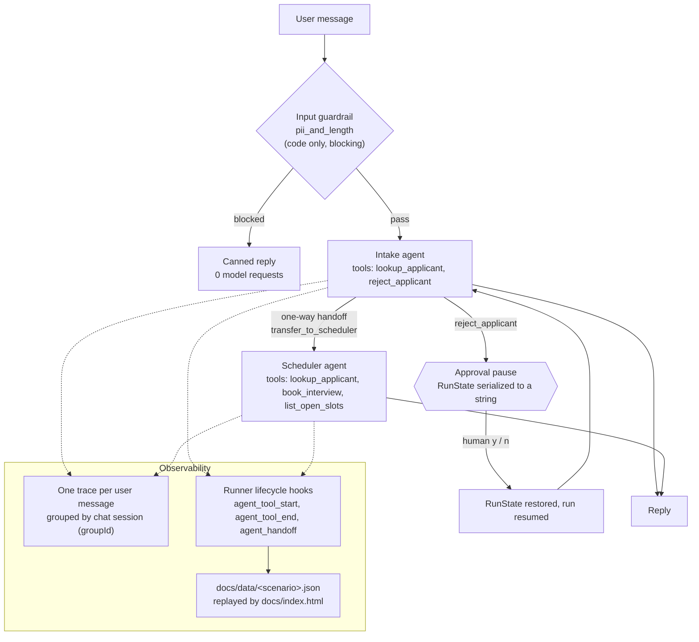

# Applicant Intake Agent

## What it is

A small command-line recruiting assistant built on the OpenAI Agents SDK for TypeScript (`@openai/agents` 0.20.0) and `gpt-5.6-luna`. A recruiter chats with it to look up applicants, book interview slots and reject applicants. Two agents share the work: an Intake agent that answers questions and routes, and a Scheduler agent that books interviews. A code-only input guardrail stops messages that look like they contain a Social Security number (or are too long) before any model request is sent, and rejecting an applicant pauses the run until a human approves or declines. Every run can be recorded to JSON and replayed in plain language on a static page in `docs/`.

Live demo: (added after deploy)

## Architecture



Source layout:

| Path | Role |
| --- | --- |
| `src/index.ts` | Chat loop, the shared `Runner`, approval handling, tracing, usage reporting |
| `src/agents/` | Intake and Scheduler agents, the handoff wiring, optional reasoning effort |
| `src/tools/` | The four function tools; all business rules live here |
| `src/guardrails/piiGuardrail.ts` | The code-only input guardrail |
| `src/lib/recorder.ts` | Event recorder for the replay page, attached to the Runner's hooks |
| `src/lib/requestCounter.ts` | Counts Responses API calls at the HTTP layer |
| `src/data/` | In-memory applicants and interview slots |
| `docs/` | Static replay page and the four recordings |
| `scripts/check-recordings.mjs` | Fails if a recording holds an SSN-shaped value |

## How it works

**Agent loop and turns.** Each user message is one call to `runner.run()`. Inside it the SDK loops: call the model, run any tool calls it asked for, feed the results back, and repeat until the model produces a final text answer or hands off to another agent. Each model call is one SDK turn; `maxTurns` is capped at 8 so a confused agent cannot loop forever.

**Session.** A single `MemorySession` holds the conversation, so the agents remember earlier messages ("What stage is Sam in?" can follow a question about Maria). Each run appends its new items to the session.

**Triage routing.** Every user message starts at the Intake agent. When the message is about booking or availability, Intake calls `transfer_to_scheduler`, a one-way handoff, and the Scheduler finishes that run. The Scheduler has no handoff back. An earlier version had handoffs in both directions; the agents would sometimes pass a request back and forth (ping-pong) instead of answering it, burning model requests. With one-way handoffs and triage at the start of every message, there is no cycle to fall into. The Scheduler also has `lookup_applicant`, so it can answer a follow-up about an applicant without handing back.

**Business rules in tool code, not the prompt.** `book_interview` refuses unknown applicants, rejected applicants, applicants who already hold a slot, and slots that are taken, and returns a structured reason (`{ booked: false, reason: 'slot taken', openSlots: [...] }`). The `slot` parameter is a Zod enum of the real slots. The prompt only tells the model to trust what the tool returns. A model can be talked out of an instruction; it cannot talk the tool out of an `if`.

**Code-only input guardrail.** `pii_and_length` is a regex and a length check with `runInParallel: false`, so the SDK waits for it before preparing the first model request. When it trips, the SDK throws `InputGuardrailTripwireTriggered`, the app prints a canned reply, and no request reaches the model. Because it is plain code, it costs nothing and cannot be argued with.

**Human approval with serialized state.** `reject_applicant` has `needsApproval: true`. When the model calls it, the run stops with an interruption instead of executing the tool. The app asks the human, calls `state.approve()` or `state.reject()` with a message telling the model not to retry, then serializes the paused run with `result.state.toString()`, restores it with `RunState.fromStringWithContext()`, and resumes with `runner.run(agent, restoredState)`. The round trip through a string is deliberate: it proves the pause could be stored in a database and resumed later by another process. Decisions go to an audit log in the run context.

**SDK lifecycle hooks for the recorder.** The app uses one `Runner` instance for every run and resume. The recorder subscribes to the Runner's `agent_tool_start` and `agent_tool_end` events (keyed by `toolCall.callId` to measure duration) and to `agent_handoff`. Tools, the guardrail and the agents do not import the recorder at all. Guardrail results are read from `result.inputGuardrailResults`, or from the tripwire error's `.result` when blocked, and are placed on the timeline at the moment the run started. Recording is off unless `RECORD=<name>` is set.

**Tracing.** Each user message runs inside its own `withTrace('Recruiter chat turn')`, so the first run, any approval resumes and the guardrail outcome all land in one trace. Every trace in a chat session shares a `groupId`, so a whole conversation can be filtered together on the OpenAI traces dashboard. Traces are flushed before the process exits so piped runs are not lost.

## Measured results

All numbers below come from the four recordings in `docs/data/`, recorded in this commit with `RECORD=<name> npm start < test-inputs/<file>`, and from the console output of those same runs. Default reasoning effort, `gpt-5.6-luna`. Model output varies between runs, so treat token counts as one sample, not an average.

| Scenario (input file) | Turns | Model requests | Input tokens | Cached input tokens | Output tokens | Cost |
| --- | --- | --- | --- | --- | --- | --- |
| lookup (`lookup.txt`) | 3 | 5 | 2,748 | 0 | 112 | about 0.07 cents |
| booking (`booking.txt`) | 4 | 17 | 14,882 | 4,629 | 374 | about 0.26 cents |
| guardrail (`step4.txt`) | 6 | 5 | 2,846 | 0 | 110 | about 0.07 cents |
| approval (`step5.txt`) | 3 | 8 | 5,345 | 0 | 199 | about 0.13 cents |

How each was measured:

- **Model requests**: summed from the SDK's `result.state.usage.requests` over every part of each turn, including resumes after approval. Cross-checked against a separate counter that wraps the OpenAI client's `fetch` and counts calls to `/responses`; the two agreed on every turn of every scenario.
- **Input, cached and output tokens**: summed from the SDK usage (`inputTokens`, `cached_tokens` in `inputTokensDetails`, `outputTokens`) over every part of each turn. The only cache hit was the fourth booking turn (4,629 of 6,005 input tokens cached).
- **Cost**: uncached input at $0.20, cached input at $0.02 and output at $1.20 per million tokens, computed by the replay page from the recorded token counts.
- **Guardrail blocks with 0 model requests**: in the guardrail scenario, the three blocked messages (two SSN-shaped, one over 2,000 characters) each recorded 0 requests and 0 tokens, and the HTTP counter printed `model requests this turn=0` for each. The session item count did not change on those turns (stayed at 4, 8 and 8), so blocked text never entered the conversation history.
- **State size at the approval pause**: the serialized `RunState` was 22,947 bytes for the first rejection (approved) and 24,676 bytes for the second (declined), measured with `Buffer.byteLength(result.state.toString())` just before restoring.
- **Requests per approval turn**: 3 model requests for each rejection turn (lookup, the paused `reject_applicant` call, and the reply after resume), from the HTTP counter.
- **Recorder move to lifecycle hooks**: the re-recorded scenarios have the same event counts as the recordings made with in-tool recording (17, 33, 32 and 24 events), and the same event sequence, agent, tool, arguments and tool output on every line, compared with a script that diffs one summary line per event.

## Run it

Requires Node 22 or newer and an OpenAI API key.

```bash
cp .env.example .env
```

Put your key in `.env`, then:

```bash
npm install
```

```bash
npm start
```

That starts an interactive chat (type `exit` to quit). The four demo scenarios pipe a file of messages instead:

```bash
npm start < test-inputs/lookup.txt
```

```bash
npm start < test-inputs/booking.txt
```

```bash
npm start < test-inputs/step4.txt
```

```bash
npm start < test-inputs/step5.txt
```

To re-record a scenario for the replay page, set `RECORD` to its name (`lookup`, `booking`, `guardrail` or `approval`), which writes `docs/data/<name>.json`:

```bash
RECORD=guardrail npm start < test-inputs/step4.txt
```

Check that no recording contains an SSN-shaped value:

```bash
npm run check:recordings
```

Type-check:

```bash
npm run typecheck
```

To view the replay page, serve `docs/` with any static file server (it loads the JSON with `fetch`, so opening the file directly will not work):

```bash
python3 -m http.server 8000 --directory docs
```

## Known limitations

- **In-memory everything.** Applicants, bookings, the audit log and the chat session live in process memory and are reset on every start. The serialized approval state is only round-tripped in memory, not actually stored.
- **Regex-only PII check.** The guardrail recognises SSN-shaped digit runs and overlong messages. It does not detect names, addresses, emails, other ID formats or SSNs written out in words, and it can block harmless nine-digit numbers.
- **Single process, single user.** One chat loop on stdin; there is no server, authentication or concurrency control, and two recruiters could not share the booking data.
- **The replay page shows recordings, not live calls.** It replays the JSON in `docs/data/`; nothing on the page calls a model.
- **Sensitive data in traces.** `traceIncludeSensitiveData` is left at its default, so traces uploaded to OpenAI contain message text and tool inputs and outputs. With real applicant data it should be turned off or the data redacted first.
- **Guardrail only on the first agent.** Input guardrails run on the run's first agent. That covers all input today because every message starts at Intake; a routing change that starts runs at the Scheduler would need the guardrail added there.
- **Name matching is a substring match.** "Sam" matches both Sam Rivera and Sam Chen and the agent has to ask; there is no fuzzy matching.
- **Small, single-sample measurements.** The numbers above come from one recording per scenario, not repeated runs, and model behaviour varies between runs.
