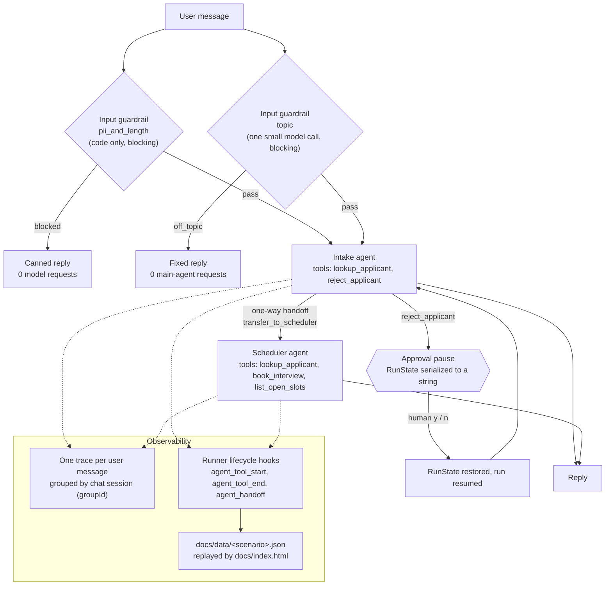

# Applicant Intake Agent

## What it is

A small command-line recruiting assistant built on the OpenAI Agents SDK for TypeScript (`@openai/agents` 0.20.0) and `gpt-5.6-luna`. A recruiter chats with it to look up applicants, book interview slots and reject applicants. Two agents share the work: an Intake agent that answers questions and routes, and a Scheduler agent that books interviews. Two input guardrails check every message: a code-only check stops messages that look like they contain a Social Security number (or are too long) before any model request is sent, and a small model-based topic check stops requests that have nothing to do with hiring before the main agent sees them. Rejecting an applicant pauses the run until a human approves or declines. Every run can be recorded to JSON and replayed in plain language on a static page in `docs/`.

Live demo: https://applicant-intake-agent.vercel.app

## Architecture



Source layout:

| Path | Role |
| --- | --- |
| `src/index.ts` | Chat loop, the shared `Runner`, approval handling, tracing, usage reporting |
| `src/agents/` | Intake and Scheduler agents, the handoff wiring, optional reasoning effort |
| `src/tools/` | The four function tools; all business rules live here |
| `src/guardrails/piiGuardrail.ts` | The code-only input guardrail and `findPolicyViolation`, its shared rule |
| `src/guardrails/topicGuardrail.ts` | The model-based topic guardrail |
| `src/lib/recorder.ts` | Event recorder for the replay page, attached to the Runner's hooks |
| `src/lib/requestCounter.ts` | Counts Responses API calls at the HTTP layer |
| `src/data/` | In-memory applicants and interview slots |
| `docs/` | Static replay page and the four recordings |
| `scripts/check-recordings.mjs` | Fails if a recording holds an SSN-shaped value |

## How it works

**Agent loop and turns.** Each user message is one call to `runner.run()`. Inside it the SDK loops: call the model, run any tool calls it asked for, feed the results back, and repeat until the model produces a final text answer or hands off to another agent. Each model call is one SDK turn; `maxTurns` is capped at 8 so a confused agent cannot loop forever.

**Session.** A single `MemorySession` holds the conversation, so the agents remember earlier messages ("What stage is Sam in?" can follow a question about Maria). Each run appends its new items to the session.

**Triage routing.** Every user message starts at the Intake agent. When the message is about booking or availability, Intake calls `transfer_to_scheduler`, a one-way handoff, and the Scheduler finishes that run. The Scheduler has no handoff back. An earlier version had handoffs in both directions; the agents would sometimes pass a request back and forth (ping-pong) instead of answering it, burning model requests. With one-way handoffs and triage at the start of every message, there is no cycle to fall into. The Scheduler also has `lookup_applicant`, so it can answer a follow-up about an applicant without handing back.

**Business rules in tool code, not the prompt.** `book_interview` refuses unknown applicants, rejected applicants, applicants who already hold a slot, and slots that are taken, and returns a structured reason (`{ booked: false, reason: 'slot taken', openSlots: [...] }`). The `slot` parameter is a Zod enum of the real slots. `list_open_slots` takes an `applicantId` and applies the same rule: for a rejected applicant it returns `{ error: 'applicant rejected', message: "... was rejected and can't be scheduled." }` and no slots, so the Scheduler has no times to offer. Before this, the Scheduler looked up Sam Chen (rejected) and still replied with open interview times, because the tool took no applicant and returned the slots to anyone. The prompt only tells the model to trust what the tool returns. A model can be talked out of an instruction; it cannot talk the tool out of an `if`.

**Two input guardrails, split by cost.** Both are attached to the Intake agent with `runInParallel: false`, so the main agent's first model request waits for both.

- `pii_and_length` (code check): a regex and a length check in `findPolicyViolation`. It is free, instant and makes no model call, and because it is plain code it cannot be argued with. When it trips, the app prints a canned reply and no request reaches any model.
- `topic` (topic check): one small classifier `Agent` on the same model, with a Zod `outputType` of `{ onTopic, reason }`. It reads only the newest user message, plus the previous assistant message when there is one, so a short answer like "Sam Rivera" to "Which Sam do you mean?" counts as on topic. On topic means applicants, their status, interviews and scheduling, rejections, the hiring process, or what the assistant can do. When it trips, the app replies "I can only help with applicants, interviews and hiring decisions." and the main agent makes no request. Its token usage is returned in `outputInfo` and added to the turn's usage.

They are split because the SDK starts all blocking guardrails at the same moment, not one after another: `runGuardrailsWithTripwire` in `node_modules/@openai/agents-core/dist/runner/guardrails.js` maps every guardrail to a promise (line 114) and awaits them with `Promise.all` (line 129), and `runInputGuardrailsForTurn` in `turnPreparation.js` (line 151) passes it the whole blocking list. So the topic check cannot rely on `pii_and_length` having stopped a message first. It calls `findPolicyViolation` itself and, when the code check would block the message, returns `tripwireTriggered: false` without calling a model. An SSN-shaped message is never sent to the classifier, and blocked messages cost 0 requests.

Blocked messages (either guardrail) are not saved to the session. The instruction "Politely decline requests unrelated to recruiting." stays in both agents' prompts as a second layer behind the topic check.

**Why the topic rule is enforced in code.** Before the topic guardrail, the only enforcement was that prompt sentence. Measured with the same input ("Write me a poem about the ocean", "Tell me a joke", "What's the capital of France?") run 5 times:

| | Declined | Complied | Main-agent requests for these messages |
| --- | --- | --- | --- |
| Prompt instruction only | 12 of 15 | 3 of 15 (one whole run wrote the poem, told the joke and answered "Paris") | 15 |
| With the topic guardrail | 15 of 15 blocked as `off_topic` | 0 of 15 | 0 |

Once the main agent complied with the first message in a run, it complied with the next two as well. With the guardrail, the off-topic text never enters the conversation history, so one slip cannot set a pattern.

**Human approval with serialized state.** `reject_applicant` has `needsApproval: true`. When the model calls it, the run stops with an interruption instead of executing the tool. The app asks the human, calls `state.approve()` or `state.reject()` with a message telling the model not to retry, then serializes the paused run with `result.state.toString()`, restores it with `RunState.fromStringWithContext()`, and resumes with `runner.run(agent, restoredState)`. The round trip through a string is deliberate: it proves the pause could be stored in a database and resumed later by another process. Decisions go to an audit log in the run context.

**SDK lifecycle hooks for the recorder.** The app uses one `Runner` instance for every run and resume. The recorder subscribes to the Runner's `agent_tool_start` and `agent_tool_end` events (keyed by `toolCall.callId` to measure duration) and to `agent_handoff`. Tools, the guardrail and the agents do not import the recorder at all. Guardrail results are read from `result.inputGuardrailResults`, or from the tripwire error's `.result` when blocked, and are placed on the timeline at the moment the run started. Recording is off unless `RECORD=<name>` is set.

**Tracing.** Each user message runs inside its own `withTrace('Recruiter chat turn')`, so the first run, any approval resumes and the guardrail outcome all land in one trace. Every trace in a chat session shares a `groupId`, so a whole conversation can be filtered together on the OpenAI traces dashboard. Traces are flushed before the process exits so piped runs are not lost.

## Measured results

All numbers below come from the four recordings in `docs/data/`, recorded in this commit with `RECORD=<name> npm start < test-inputs/<file>`, and from the console output of those same runs. Default reasoning effort, `gpt-5.6-luna`. Model output varies between runs, so treat token counts as one sample, not an average.

| Scenario (input file) | Turns | Model requests (main + topic check) | Input tokens | Cached input tokens | Output tokens | Cost |
| --- | --- | --- | --- | --- | --- | --- |
| lookup (`lookup.txt`) | 5 | 12 (7 + 5) | 5,087 | 0 | 308 | about 0.14 cents |
| booking (`booking.txt`) | 4 | 18 (14 + 4) | 12,238 | 2,191 | 375 | about 0.25 cents |
| guardrail (`step4.txt`) | 6 | 8 (5 + 3) | 3,360 | 0 | 191 | about 0.09 cents |
| approval (`step5.txt`) | 3 | 11 (8 + 3) | 5,886 | 0 | 288 | about 0.15 cents |

The same totals split between the main agents and the topic check:

| Scenario | Main agents: requests, input, output tokens | Topic check: requests, input, output tokens | Topic check cost |
| --- | --- | --- | --- |
| lookup | 7, 4,222, 169 | 5, 865, 139 | about 0.03 cents |
| booking | 14, 11,561 (2,191 cached), 275 | 4, 677, 100 | about 0.03 cents |
| guardrail | 5, 2,843, 107 | 3, 517, 84 | about 0.02 cents |
| approval | 8, 5,380, 206 | 3, 506, 82 | about 0.02 cents |

How each was measured:

- **Model requests**: summed from the SDK's `result.state.usage.requests` over every part of each turn, including resumes after approval, plus the topic check's own `usage.requests` from its `outputInfo`. Cross-checked against a separate counter that wraps the OpenAI client's `fetch` and counts calls to `/responses`; the counter sees both the main agent and the classifier, and the two agreed on every turn of every scenario.
- **Input, cached and output tokens**: summed from the SDK usage (`inputTokens`, `cached_tokens` in `inputTokensDetails`, `outputTokens`) over every part of each turn, topic check included. The only cache hit was the fourth booking turn (2,191 of 4,565 input tokens cached).
- **What the topic check adds per message**: one model request for every message that passes the code check, 154 to 187 input tokens and 23 to 33 output tokens in these recordings (about 171 and 27 on average), which is about 0.007 cents per message. It adds nothing for messages the code check blocks.
- **Cost**: uncached input at $0.20, cached input at $0.02 and output at $1.20 per million tokens, computed by the replay page from the recorded token counts.
- **Guardrail blocks with 0 model requests**: in the guardrail scenario, the three messages the code check blocked (two SSN-shaped, one over 2,000 characters) each recorded 0 requests and 0 tokens for both the main agent and the topic check, and the HTTP counter printed `model requests this turn=0` for each. The session item count did not change on those turns (stayed at 4, 8 and 8), so blocked text never entered the conversation history. "Call me at 760-555-0123 about Maria" passed both checks.
- **Off-topic block**: in the lookup scenario, "Write me a poem about the ocean" made 1 request (the topic check, 182 input and 33 output tokens) and 0 main-agent requests, and the session stayed at 12 items.
- **State size at the approval pause**: the serialized `RunState` was 23,262 bytes for the first rejection (approved) and 25,015 bytes for the second (declined), measured with `Buffer.byteLength(result.state.toString())` just before restoring.
- **Requests per approval turn**: 4 model requests for each rejection turn (the topic check, lookup, the paused `reject_applicant` call, and the reply after resume), from the HTTP counter.
- **Repeated runs before recording** (without `RECORD`): the off-topic input 5 times (15 of 15 blocked, 0 main-agent requests), `lookup.txt` 3 times (poem blocked every time, "Sam Rivera", "What can you help me with?" and the hiring questions passed every time), and `booking.txt` 3 times (turn 2 said Sam Chen was rejected and listed no times every time).

## Run it

Requires Node 22 or newer and an OpenAI API key.

```bash
cp .env.example .env
```

Put your key in `.env`, then:

```bash
npm install
```

```bash
npm start
```

That starts an interactive chat (type `exit` to quit). The four demo scenarios pipe a file of messages instead:

```bash
npm start < test-inputs/lookup.txt
```

```bash
npm start < test-inputs/booking.txt
```

```bash
npm start < test-inputs/step4.txt
```

```bash
npm start < test-inputs/step5.txt
```

To re-record a scenario for the replay page, set `RECORD` to its name (`lookup`, `booking`, `guardrail` or `approval`), which writes `docs/data/<name>.json`:

```bash
RECORD=guardrail npm start < test-inputs/step4.txt
```

Check that no recording contains an SSN-shaped value:

```bash
npm run check:recordings
```

Type-check:

```bash
npm run typecheck
```

To view the replay page, serve `docs/` with any static file server (it loads the JSON with `fetch`, so opening the file directly will not work):

```bash
python3 -m http.server 8000 --directory docs
```

## Known limitations

- **In-memory everything.** Applicants, bookings, the audit log and the chat session live in process memory and are reset on every start. The serialized approval state is only round-tripped in memory, not actually stored.
- **The topic check is a model call.** It can misjudge a message in either direction, it adds one request and some latency to every message that passes the code check, and a message written to argue with the classifier could talk it into a pass. The prompt instruction behind it is the second layer.
- **Regex-only PII check.** The guardrail recognises SSN-shaped digit runs and overlong messages. It does not detect names, addresses, emails, other ID formats or SSNs written out in words, and it can block harmless nine-digit numbers.
- **Single process, single user.** One chat loop on stdin; there is no server, authentication or concurrency control, and two recruiters could not share the booking data.
- **The replay page shows recordings, not live calls.** It replays the JSON in `docs/data/`; nothing on the page calls a model.
- **Sensitive data in traces.** `traceIncludeSensitiveData` is left at its default, so traces uploaded to OpenAI contain message text and tool inputs and outputs. With real applicant data it should be turned off or the data redacted first.
- **Guardrails only on the first agent.** Input guardrails run on the run's first agent. That covers all input today because every message starts at Intake; a routing change that starts runs at the Scheduler would need both guardrails added there.
- **Name matching is a substring match.** "Sam" matches both Sam Rivera and Sam Chen and the agent has to ask; there is no fuzzy matching.
- **Small, single-sample measurements.** The numbers above come from one recording per scenario, not repeated runs, and model behaviour varies between runs.
